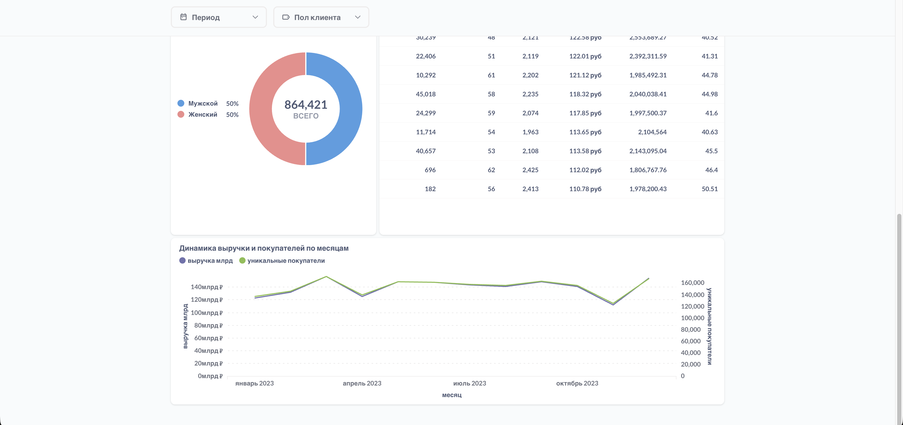

# 📊 E-commerce Analytics Platform

Полноценная аналитическая платформа для онлайн-маркетплейса: от автоматизированного сбора данных (ETL) до BI-визуализации и когортного анализа. Проект демонстрирует end-to-end подход к построению data-инфраструктуры и извлечению бизнес-инсайтов из сырых данных.

## 💼 Бизнес-ценность

Платформа решает ключевые задачи аналитики маркетплейса:
- **Автоматизация:** Ежедневный сбор данных по API без ручного вмешательства (Cron + идемпотентный ETL).
- **Качество данных:** Валидация на лету, обработка ошибок сети (retry-логика) и защита от дубликатов.
- **Глубокая аналитика:** Выявление узких мест в воронке (например, критически низкий Retention Rate ~15% и аномальные провалы активности) с расчётом потенциального экономического эффекта.
- **Визуализация:** Интерактивные дашборды для мониторинга ключевых метрик (GMV, уникальные покупатели, средний чек, когорты) в реальном времени.

## 🛠 Технологический стек

| Категория | Технологии |
|---|---|
| **Инфраструктура** | Ubuntu 22.04, Docker, Docker Compose |
| **База данных** | PostgreSQL 15 (с индексами, CHECK-ограничениями и материализованными View) |
| **ETL / Data Engineering** | Python 3.10, `requests`, `pandas`, `SQLAlchemy`, `psycopg2` |
| **BI / Визуализация** | Metabase v0.49.10 |
| **Оркестрация** | Cron (ежедневный запуск в 07:00) |
| **Аналитика** | Когортный анализ, RFM-сегментация, ABC/XYZ-анализ |

## 🚀 Быстрый старт (Local Development)

### 1. Клонирование и настройка окружения
```bash
git clone https://github.com/alexeishuster/marketplace-data-diploma.git
cd marketplace-data-diploma
cp .env.example .env
# Отредактируйте .env, указав POSTGRES_PASSWORD и другие параметры
docker compose up -d
python3 -m venv venv
source venv/bin/activate
pip install -r requirements.txt
python scripts/fetch_data.py backfill
python scripts/fetch_data.py daily
├── db/
│   └── schema.sql              # DDL-скрипт с индексами, ограничениями и View
├── scripts/
│   ├── fetch_data.py           # Production-ready ETL-пайплайн с retry и валидацией
│   ├── analysis_assortment.py  # Скрипт ABC/XYZ-анализа ассортиментной матрицы
│   └── analysis_rfm_ltv.py     # Скрипт RFM-сегментации и расчёта LTV
├── docs/
│   ├── Report_1_Assortment.md  # Бизнес-отчёт по оптимизации ассортимента
│   └── Report_2_Client_LTV.md  # Бизнес-отчёт по стратегии удержания клиентов
├── outputs/                    # Сгенерированные PNG-визуализации
├── docker-compose.yml          # Оркестрация PostgreSQL и Metabase
├── requirements.txt            # Зависимости Python
└── .env.example                # Шаблон переменных окружения

---

### **Проверка Шага 2:**

1. Убедитесь, что файл обновился:
   ```bash
   head -n 15 README.md
   cat > .env.example << 'EOF'
POSTGRES_DB=marketplace
POSTGRES_USER=analyst
POSTGRES_PASSWORD=your_secure_password_here
POSTGRES_HOST=localhost
POSTGRES_PORT=5432

API_URL=http://final-project.simulative.ru/data/
API_BACKFILL_START=2023-01-01
API_BACKFILL_END=2023-12-31

LOG_LEVEL=INFO
# 📊 E-commerce Analytics Platform

Полноценная аналитическая платформа для онлайн-маркетплейса: от автоматизированного сбора данных (ETL) до BI-визуализации и когортного анализа. Проект демонстрирует end-to-end подход к построению data-инфраструктуры и извлечению бизнес-инсайтов из сырых данных.

## 💼 Бизнес-ценность

Платформа решает ключевые задачи аналитики маркетплейса:
- **Автоматизация:** Ежедневный сбор данных по API без ручного вмешательства (Cron + идемпотентный ETL).
- **Качество данных:** Валидация на лету, обработка ошибок сети (retry-логика) и защита от дубликатов.
- **Глубокая аналитика:** Выявление узких мест в воронке (например, критически низкий Retention Rate ~15% и аномальные провалы активности) с расчётом потенциального экономического эффекта.
- **Визуализация:** Интерактивные дашборды для мониторинга ключевых метрик (GMV, уникальные покупатели, средний чек, когорты) в реальном времени.

## 🛠 Технологический стек

| Категория | Технологии |
|---|---|
| **Инфраструктура** | Ubuntu 22.04, Docker, Docker Compose |
| **База данных** | PostgreSQL 15 (с индексами, CHECK-ограничениями и View) |
| **ETL / Data Engineering** | Python 3.10, requests, pandas, SQLAlchemy, psycopg2 |
| **BI / Визуализация** | Metabase v0.49.10 |
| **Оркестрация** | Cron (ежедневный запуск в 07:00) |
| **Аналитика** | Когортный анализ, RFM-сегментация, ABC/XYZ-анализ |

## 🚀 Быстрый старт

1. Клонирование и настройка:
   git clone https://github.com/alexeishuster/marketplace-data-diploma.git
   cd marketplace-data-diploma
   cp .env.example .env  # Отредактируйте .env, указав реальные пароли

2. Запуск инфраструктуры:
   docker compose up -d

3. Установка зависимостей Python:
   python3 -m venv venv
   source venv/bin/activate
   pip install -r requirements.txt

4. Загрузка данных:
   python scripts/fetch_data.py backfill  # Историческая загрузка
   python scripts/fetch_data.py daily     # Ежедневное обновление


   ## 📸 Скриншоты дашборда

   **Главный KPI-дашборд** (с интерактивными фильтрами по дате и полу):
   

   **Пример работы фильтров** (например, фильтрация по полу и месяцу):
   

   **Пример Native SQL-запроса** с использованием переменных Metabase (`{{date_filter}}`, `{{gender_filter}}`):
   

## 📁 Структура репозитория

- db/schema.sql: DDL-скрипт с индексами, ограничениями и View
- scripts/fetch_data.py: Production-ready ETL-пайплайн с retry и валидацией
- scripts/analysis_*.py: Скрипты ABC/XYZ и RFM/LTV анализа


- docs/: Бизнес-отчёты по оптимизации ассортимента и удержанию клиентов
- outputs/: Сгенерированные PNG-визуализации и скриншоты дашбордов

## 📈 Ключевые аналитические инсайты (2023)

На основе обработки 2+ млн транзакций и 864K+ уникальных клиентов были выявлены:
1. Критический отток: Retention Rate на 2-й месяц составляет всего ~15.5% (норма для e-commerce: 30-40%).
2. Зависимость от acquisition: Выручка коррелирует с притоком новых клиентов на 99%. В ноябре приток новых упал на 83%, что вызвало локальный провал GMV.
3. Неэффективность плоских скидок: Эффективный дисконт стабильно держится на уровне ~50% круглый год, не стимулируя повторные покупки в "мёртвые" сезоны.

Подробные расчёты и бизнес-рекомендации с оценкой ROI доступны в папке docs/.

## 🔒 Безопасность и Best Practices

- Пароли и секреты вынесены в .env и не хранятся в коде.
- Docker Compose настроен с fail-fast проверкой обязательных переменных окружения.
- ETL-скрипт идемпотентен: повторный запуск за тот же день не создаёт дубликатов (ON CONFLICT DO NOTHING).
- Используется строгая типизация (Type Hints) и логирование (stdout + file) в Python-скриптах.

---
**Автор:** Алексей Шустер | GitHub: github.com/alexeishuster

