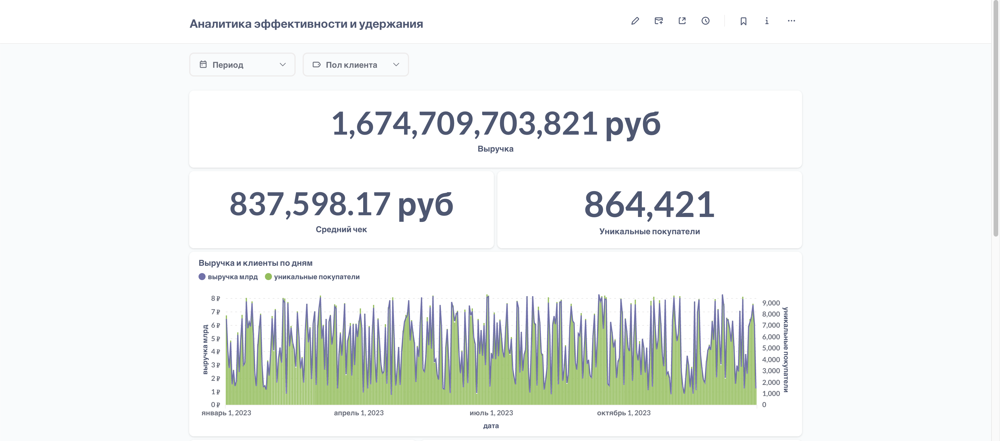
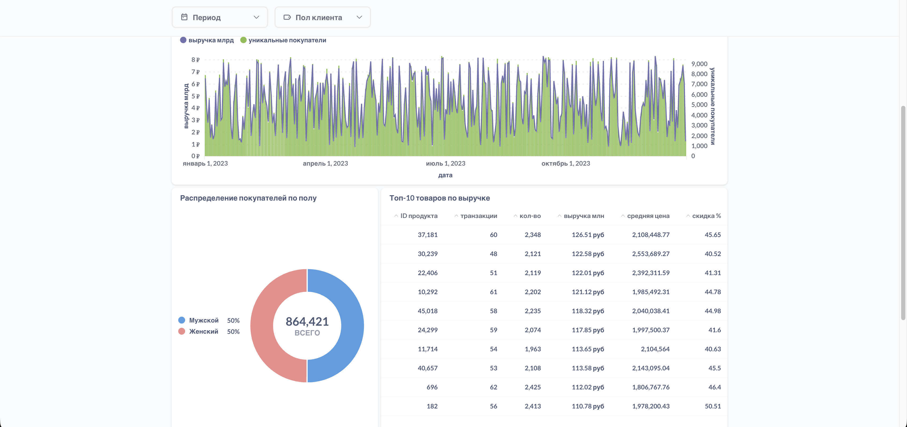

# 📊 E-commerce Analytics Platform

Полноценная аналитическая платформа для онлайн-маркетплейса: от автоматизированного сбора данных (ETL) до BI-визуализации и когортного анализа.

**🔗 Публичный дашборд (без 

## 📝 Мониторинг и логирование

ETL-скрипт использует двухуровневое логирование (stdout + файл `logs/etl.log`). Пример успешного ежедневного запуска:

text
2023-12-31 07:00:01,123 - __main__ - INFO - Запуск ETL-пайплайна. Режим: daily
2023-12-31 07:00:01,125 - __main__ - INFO - Подключение к базе данных: marketplace@localhost:5432
2023-12-31 07:00:01,150 - __main__ - INFO - Запрос данных за дату: 2023-12-31
2023-12-31 07:00:02,890 - __main__ - INFO - ✓ 2023-12-31: получено 8092 записей
2023-12-31 07:00:02,891 - __main__ - INFO - Валидация данных: 8092 из 8092 записей прошли проверку
2023-12-31 07:00:03,105 - __main__ - INFO - Загрузка за 2023-12-31: 0 записей (дубликаты пропущены благодаря ON CONFLICT)
2023-12-31 07:00:03,106 - __main__ - INFO - ETL-пайплайн успешно завершён. Время выполнения: 1.98 сек.

авторизации):**  
http://185.177.216.7:3000/public/dashboard/d08c00a8-94f1-434b-baed-b296b83b3ddb

## 💼 Бизнес-ценность
- **Автоматизация:** Ежедневный сбор данных по API без ручного вмешательства.
- **Качество данных:** Валидация на лету, retry-логика, защита от дубликатов.
- **Глубокая аналитика:** Выявление узких мест (Retention Rate ~15%, провалы активности).
- **Визуализация:** Интерактивные дашборды с фильтрами по дате и полу.

## 🛠 Технологический стек
| Категория | Технологии |
|---|---|
| Инфраструктура | Ubuntu 22.04, Docker, Docker Compose |
| База данных | PostgreSQL 15 (индексы, CHECK, View) |
| ETL | Python 3.10, requests, pandas, SQLAlchemy, psycopg2 |
| BI | Metabase v0.49.10 |
| Оркестрация | Cron (ежедневный запуск в 07:00) |

## 📸 Скриншоты дашборда
**Главный KPI-дашборд** (с фильтрами по дате и полу):

**Пример работы фильтров**:

**Пример Native SQL-запроса**:

## 🚀 Быстрый старт
1. Клонирование: `git clone https://github.com/alexeishuster/marketplace-data-diploma.git`
2. Конфигурация: `cp .env.example .env` (укажите реальные значения)
3. Запуск: `docker compose up -d`
4. Зависимости: `python3 -m venv venv && source venv/bin/activate && pip install -r requirements.txt`
5. Загрузка данных: `python scripts/fetch_data.py backfill`

## 📁 Структура репозитория
- `db/schema.sql` — DDL-скрипт с индексами и View
- `scripts/fetch_data.py` — Production-ready ETL-пайплайн
- `docs/` — Бизнес-отчёты и скриншоты дашбордов
- `.env.example` — Шаблон переменных окружения

## 📈 Ключевые инсайты (2023)
1. **Критический отток:** Retention Rate на 2-й месяц ~15.5% (норма 30-40%).
2. **Зависимость от acquisition:** Выручка коррелирует с притоком новых клиентов на 99%.
3. **Неэффективность плоских скидок:** Эффективный дисконт ~50% круглый год.

## 🔒 Безопасность
- Пароли вынесены в `.env`, в коде хардкод-секретов нет.
- ETL идемпотентен (`ON CONFLICT DO NOTHING`).
- Строгая типизация и логирование в Python-скриптах.

## 📄 Аналитические отчеты и презентация

В папке `docs/` размещены подробные материалы исследования (PDF):
- [Report 1: Сводка по ассортименту 2023](docs/Report_1_Assortment_Summary_2023.pdf)
- [Report 2: Краткое резюме по LTV](docs/Report_2_LTV_Summary_2023.pdf)
- [Report 3: Оптимизация ассортиментной матрицы](docs/Report_3_Optimization_Matrix.pdf)
- [Report 4: Полный анализ LTV клиентской базы 2023](docs/Report_4_Customer_LTV_Analysis_2023.pdf)

## 📄 Аналитические отчеты
В папке docs/ размещены материалы исследования:
- [Report 1: Сводка по ассортименту](docs/Report_1_Assortment_Summary_2023.pdf)
- [Report 2: Резюме по LTV](docs/Report_2_LTV_Summary_2023.pdf)
- [Report 3: Оптимизация матрицы](docs/Report_3_Optimization_Matrix.pdf)
- [Report 4: Полный анализ LTV базы](docs/Report_4_Customer_LTV_Analysis_2023.pdf)

---
**Автор:** Алексей Шустер | GitHub: github.com/alexeishuster
